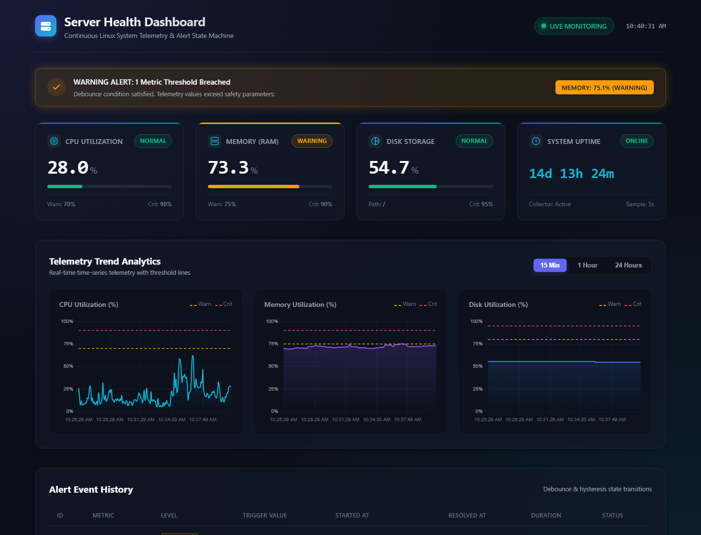
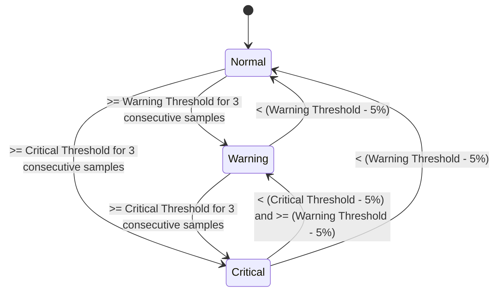
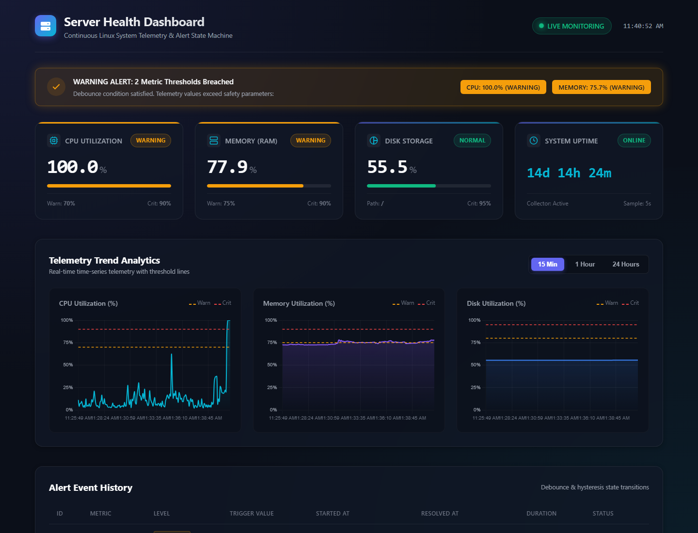
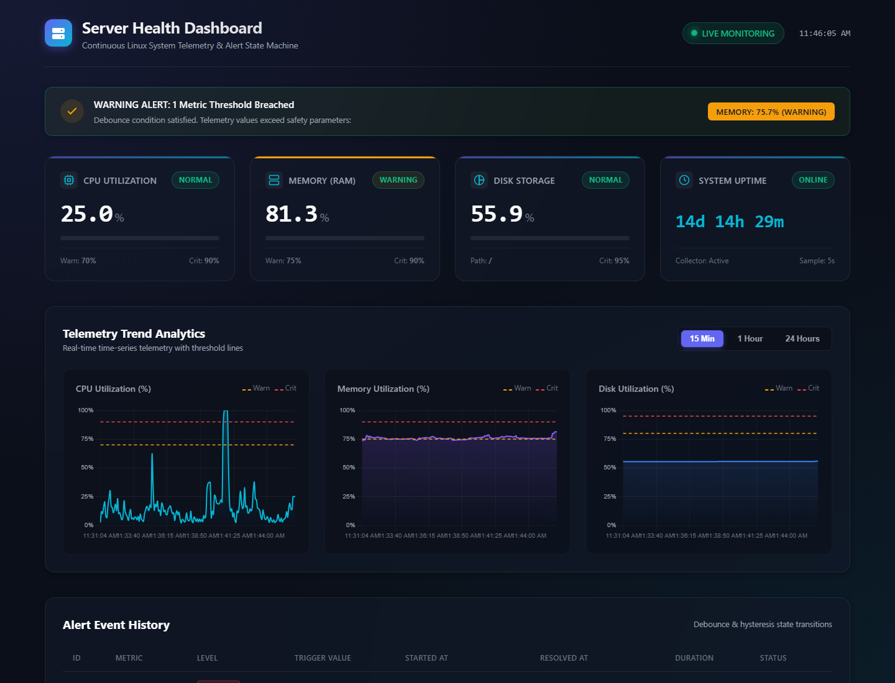

# Real-Time Server Health Dashboard

A high-performance, real-time Linux server health telemetry dashboard with decoupled background sampling, SQLite WAL history, an alert debounce and hysteresis state machine, interactive trend charts, and controlled stress testing.



---

## Table of Contents
1. [Overview & Core Features](#overview--core-features)
2. [System Architecture](#system-architecture)
3. [Quickstart & Local Setup](#quickstart--local-setup)
4. [Configuration Reference (`config.yaml`)](#configuration-reference-configyaml)
5. [Alerting State Machine (Debounce & Hysteresis)](#alerting-state-machine-debounce--hysteresis)
6. [API Specification](#api-specification)
7. [Controlled Load Testing Suite](#controlled-load-testing-suite)
8. [Production Deployment Guide](#production-deployment-guide)
9. [Security Notes](#security-notes)
10. [Visual Walkthrough & Screenshots](#visual-walkthrough--screenshots)
11. [Troubleshooting & FAQ](#troubleshooting--faq)

---

## Overview & Core Features

- **Decoupled Background Telemetry**: A background daemon thread samples CPU, memory, and disk utilization every $N$ seconds (default 5s) directly into SQLite. API endpoints only read pre-sampled telemetry, ensuring sub-millisecond response times.
- **psutil Priming**: CPU baseline counters are primed at startup with `psutil.cpu_percent(interval=None)`. The dashboard never returns or persists the meaningless `0.0%` initial sample.
- **SQLite WAL Mode**: Thread-safe concurrent read/write access with write-ahead logging (`PRAGMA journal_mode=WAL;`), normal synchronization, and a 5000ms busy timeout.
- **Debounced Alert Engine**:
  - Requires $N$ consecutive samples (default 3) above a threshold to trigger an alert, eliminating transient false alarms.
  - Implements hysteresis to resolve alerts: values must fall 5 percentage points below the trigger threshold before clearing, preventing boundary flapping.
  - Full alert lifecycle tracking (`started_at`, `resolved_at`, breach value, duration).
- **Automated Data Retention**: Purges telemetry samples older than a configurable number of days (default 7 days) during background maintenance cycles.
- **Zero-CDN Frontend**: Built with pure semantic HTML5, modern vanilla CSS with glassmorphism, responsive cards, and locally vendored standalone **Chart.js** (`static/vendor/chart.umd.min.js`).
- **Resilient Connectivity**: Polling watchdog displays an instant, prominent alert banner if the server backend is disconnected or restarting.
- **Controlled Load Testing**: Self-terminating stress testing tool with safe 80% RAM cap to prevent triggering the Linux OOM killer.

---

## System Architecture

```mermaid
graph TD
    subgraph Host System
        PSUtil[psutil: CPU, Memory, Disk, Boot Time]
    end

    subgraph Server Process (Single Gunicorn Worker / Flask)
        Lock[CollectorLock: collector.lock]
        Collector[Background Collector Thread]
        Alerts[Alert State Machine: Debounce & Hysteresis]
        DB[(SQLite WAL Database: server_health.db)]
        API[Flask REST API Endpoints]
    end

    subgraph Client Browser
        UI[Vanilla JS Dashboard + Vendored Chart.js]
    end

    Lock -->|Ensure Single Instance| Collector
    PSUtil -->|Sample every 5s| Collector
    Collector -->|Evaluate Metrics| Alerts
    Alerts -->|Persist Active / Resolved Alerts| DB
    Collector -->|Insert Metrics & Run Retention| DB
    API -->|Read-only Queries| DB
    UI -->|Poll /api/metrics (every 3s)| API
    UI -->|Fetch /api/history & /api/alerts| API
```

### Why a Single Gunicorn Worker Is Required
The background collector runs as an in-process thread. Spawning multiple Gunicorn worker processes (`--workers > 1`) would cause:
1. **Duplicate metric samples** inserted at identical timestamps.
2. **Race conditions** in alert debounce counters across separate worker memories.
3. **Write lock contention** on SQLite.

Therefore, Gunicorn is configured with `--workers 1 --threads 4`. The single worker hosts the singleton collector thread, while the 4 worker threads handle concurrent HTTP requests without blocking the telemetry loop. Furthermore, an inter-process file lock (`collector.lock`) prevents duplicate instances if multiple processes are started.

---

## Quickstart & Local Setup

### 1. Prerequisites
- Python 3.10+ (tested up to Python 3.13)
- `pip` and `virtualenv`

### 2. Clone and Install
```bash
git clone https://github.com/example/server-health-dashboard.git
cd server-health-dashboard

# Create virtual environment
python3 -m venv venv
source venv/bin/activate  # On Windows: .\venv\Scripts\activate

# Install dependencies
pip install -r requirements.txt
```

### 3. Run Test Suite
```bash
pytest tests/ -v
```
All unit tests covering database WAL mode, retention pruning, uptime formatting, alert debounce and hysteresis, and API endpoints will execute.

### 4. Launch Development Server
```bash
python app.py
```
Open your browser and navigate to: **`http://127.0.0.1:5000/`**

---

## Configuration Reference (`config.yaml`)

All parameters are configurable without modifying source code:

```yaml
server:
  host: "127.0.0.1"    # Bind address (use 0.0.0.0 for all interfaces)
  port: 5000           # Listening port
  debug: false         # Flask debug mode

database:
  path: "server_health.db" # SQLite database file location

collector:
  sample_interval_seconds: 5    # Background sampling frequency
  disk_path: "/"                # Filesystem mount to monitor (e.g., "/" on Linux, "C:\" on Windows)
  retention_days: 7             # Telemetry history retention period
  retention_interval_seconds: 3600 # Cleanup check frequency (1 hour)

alerts:
  debounce_samples: 3           # Consecutive breach samples required to trigger alert
  hysteresis_points: 5.0        # Percentage points below threshold required to resolve
  thresholds:
    cpu:
      warning: 70.0             # CPU warning trigger (%)
      critical: 90.0            # CPU critical trigger (%)
    memory:
      warning: 75.0             # RAM warning trigger (%)
      critical: 90.0            # RAM critical trigger (%)
    disk:
      warning: 80.0             # Disk warning trigger (%)
      critical: 95.0            # Disk critical trigger (%)
```

---

## Alerting State Machine (Debounce & Hysteresis)



- **Debounce**: A temporary spike (e.g., CPU hitting 85% for 1 or 2 samples and dipping back) will **not** trigger a false alert.
- **Hysteresis**: When a 70% CPU warning alert is active, it will only resolve when the CPU drops below **65%** ($70 - 5$). If the metric hovers at 68%, it remains active, preventing alert flapping.

---

## API Specification

All endpoints return JSON (except `/` which serves the HTML UI):

| Endpoint | Method | Query Params | Description | Sample Output |
|---|---|---|---|---|
| `/` | GET | None | Main Dashboard UI | Server-rendered HTML |
| `/health` | GET | None | Liveness check | `{"status": "ok", "uptime": "14d 14h 24m"}` |
| `/api/metrics` | GET | None | Latest sample + uptime + active alerts | `{"latest": {"cpu_percent": 25.0, ...}, "active_alerts": [...]}` |
| `/api/history` | GET | `?minutes=15` (or 60, 1440) | Time-series samples | `{"count": 180, "samples": [...]}` |
| `/api/alerts` | GET | `?limit=50` | Alert history log | `{"count": 3, "alerts": [{"id": 2, ...}]}` |
| `/api/config` | GET | None | Read-only configuration | `{"sample_interval_seconds": 5, ...}` |

---

## Controlled Load Testing Suite

The load testing suite supports controlled Before $\to$ During $\to$ After stress testing. It automatically cleans up and terminates when finished.

### 1. Using Linux `load_test.sh` (with `stress-ng` fallback)
```bash
chmod +x scripts/load_test.sh

# Run CPU stress test (30s duration, 5s baseline, 15s recovery)
./scripts/load_test.sh --mode cpu --duration 30 --before 5 --after 15

# Run Memory stress test
./scripts/load_test.sh --mode memory --duration 20

# Run combined stress test
./scripts/load_test.sh --mode both --duration 25
```

### 2. Using Pure-Python Fallback `load_test.py`
If `stress-ng` is not installed, the pure-Python multiprocessing runner executes automatically:
```bash
python scripts/load_test.py --mode cpu --duration 30 --before 5 --after 20
```

### Safety Features
- **Strict RAM Cap**: Memory allocation is hard-capped at **80% of total system RAM** to guarantee the Linux OOM (Out-of-Memory) killer is never invoked.
- **Self-Terminating**: Timed watchdog processes join and terminate cleanly.
- **Matched Timestamps**: Structured console logs print epoch timestamps so you can match the stress test duration to dashboard charts and SQLite rows.

---

## Production Deployment Guide

### Automated Linux Deployment (Ubuntu/Debian)
Run the automated installation script as root:
```bash
sudo ./deploy/setup.sh
```
This script automates:
1. Installing system packages (`python3-venv`, `nginx`, `apache2-utils`, `stress-ng`).
2. Creating `/opt/server-health-dashboard` and virtualenv.
3. Generating the `/etc/nginx/.htpasswd` authentication file.
4. Installing and enabling the `server-health-dashboard.service` systemd unit.
5. Configuring the Nginx reverse proxy and enabling security headers.

### Manual Systemd Service Setup
Copy `deploy/server-health-dashboard.service` to `/etc/systemd/system/`:
```ini
[Unit]
Description=Server Health Dashboard Telemetry Service
After=network.target

[Service]
Type=simple
User=www-data
Group=www-data
WorkingDirectory=/opt/server-health-dashboard
Environment="PATH=/opt/server-health-dashboard/venv/bin:$PATH"
ExecStart=/opt/server-health-dashboard/venv/bin/gunicorn --workers 1 --threads 4 --bind 127.0.0.1:5000 app:app
Restart=always
RestartSec=5s

[Install]
WantedBy=multi-user.target
```
Enable and start the service:
```bash
sudo systemctl daemon-reload
sudo systemctl enable --now server-health-dashboard
```

### Nginx Reverse Proxy with HTTP Basic Auth
Create the admin user credentials:
```bash
sudo htpasswd -c /etc/nginx/.htpasswd admin
```
Deploy `deploy/nginx.conf` to `/etc/nginx/sites-available/server-health-dashboard`, link to `/etc/nginx/sites-enabled/`, and reload:
```bash
sudo ln -sf /etc/nginx/sites-available/server-health-dashboard /etc/nginx/sites-enabled/
sudo nginx -t
sudo systemctl reload nginx
```

### Enabling HTTPS with Let's Encrypt (Certbot)
1. Install Certbot:
   ```bash
   sudo apt-get install -y certbot python3-certbot-nginx
   ```
2. Request and install SSL certificate:
   ```bash
   sudo certbot --nginx -d monitor.yourdomain.com
   ```
3. Verify automatic certificate renewal:
   ```bash
   sudo certbot renew --dry-run
   ```

---

## Security Notes

1. **HTTP Basic Authentication**: The Nginx reverse proxy gates all web dashboard and API endpoints behind `/etc/nginx/.htpasswd`. The `/health` liveness probe can optionally be configured without authentication for automated health-checkers.
2. **Systemd Sandboxing**: The service unit isolates the process with `ProtectSystem=full`, `ProtectHome=true`, `NoNewPrivileges=true`, and `PrivateTmp=true`.
3. **Database File Permissions**: The SQLite file (`server_health.db`) and WAL journals are restricted to `www-data:www-data` with `0640` permissions.
4. **Read-Only API Endpoints**: All public `/api/*` endpoints only perform read-only `SELECT` queries against SQLite. Modifying telemetry via HTTP is architecturally impossible.

---

## Visual Walkthrough & Screenshots

All screenshots below were captured from the live dashboard:

### 1. Baseline Idle State
System running within normal thresholds. Status badges display green "NORMAL" and the alert banner confirms operational health.


### 2. High CPU Stress Load
CPU utilization spikes to 100% during the stress phase. The CPU card transitions to amber with an active "WARNING" badge.


### 3. Active Alert Triggered (Debounce Met)
After 3 consecutive samples exceeding 70%, the alert banner fires, displaying the active alert badge and metric details.


### 4. Memory Stress Load (80% Safety Cap)
RAM allocation safely climbs towards the 80% ceiling without risking an OOM killer event.


### 5. Post-Load Recovery & Hysteresis Resolution
When the CPU drops below the hysteresis threshold ($< 65\%$), the alert is marked resolved in the SQLite table with start, end, and duration timestamps.


---

## Troubleshooting & FAQ

#### Q: Why is my dashboard showing "Disconnected"?
- Verify that Gunicorn or `python app.py` is running:
  ```bash
  sudo systemctl status server-health-dashboard
  ```
- Check application logs:
  ```bash
  journalctl -u server-health-dashboard -n 50 --no-pager
  ```

#### Q: How do I change the disk path to monitor a separate partition?
Edit `config.yaml` and set:
```yaml
collector:
  disk_path: "/data"  # or "/mnt/storage"
```
Restart the service with `sudo systemctl restart server-health-dashboard`.

#### Q: Why does the first CPU sample never read 0.0%?
The collector calls `psutil.cpu_percent(interval=None)` upon startup to establish the baseline counter delta. Subsequent readings always represent the true system CPU percentage over the sample window.

#### Q: How do I test the API directly from the command line?
```bash
curl -s http://127.0.0.1:5000/health
curl -s http://127.0.0.1:5000/api/metrics
curl -s "http://127.0.0.1:5000/api/history?minutes=15"
```
